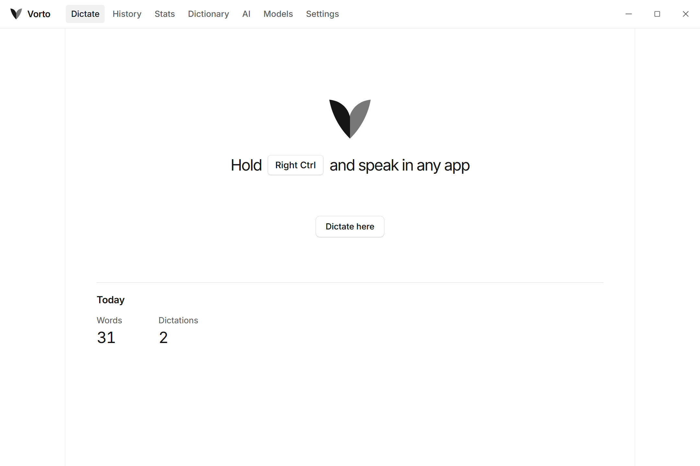

<div align="center">


# Vorto

**Talk into any app. Your voice never leaves your PC.**

### [Download for Windows](https://github.com/edgar-kessler/vorto/releases/latest/download/Vorto-Setup.exe)

<br>

<picture>
  <source media="(prefers-color-scheme: dark)" srcset="docs/images/dictate-dark.png">
  
</picture>

</div>

## How it works

Hold your shortcut, speak and let go. Your words appear where you were typing. Tap it twice to keep it on, and press once more to finish.

- **Private:** speech recognition runs on your PC. No account, no telemetry.
- **Fast:** text is there a moment after you let go, even after long dictations.
- **Learns:** correct a word once and Vorto gets it right next time.
- **Optional AI editing:** turn what you said into a clean email or a clear prompt, with a local model or a provider you choose.

## Install

Download [Vorto-Setup.exe](https://github.com/edgar-kessler/vorto/releases/latest/download/Vorto-Setup.exe), or use PowerShell:

```powershell
irm https://edgar-kessler.github.io/vorto/install.ps1 | iex
```

Vorto needs Windows 10 22H2 or 11 and a processor with AVX2, which most PCs since 2015 have. It isn't code-signed yet, so if Windows warns you, select **More info**, then **Run anyway**.

## Voice models

You pick one during setup. It downloads once, and after that dictation works offline.

| Model | Best for | Download |
|---|---|---|
| **Parakeet Ultra** | 25 European languages, recommended | 670 MB |
| **Parakeet English** | English | 661 MB |
| **Parakeet Deutsch** | German | 672 MB |
| **Parakeet v3** | 25 European languages | 670 MB |
| **Whisper Turbo** | 99 languages, with a graphics card | 574 MB |
| **Whisper Small** | 99 languages | 488 MB |
| **Whisper Base** | 99 languages, on slower PCs | 148 MB |

## Command line

All settings except API keys also work from the terminal. `vorto start` runs only the recording pill, with no window.

```powershell
vorto models download parakeet-en
vorto shortcut "Right Ctrl"
vorto words add Kubernetes
vorto start
```

`vorto help` lists the rest.

## Privacy

Your voice stays on your PC. Vorto only goes online to download voice models and check for updates. If you choose an online provider for AI editing, it receives the text of your dictations, never the audio.

## Contributing

[Open an issue](https://github.com/edgar-kessler/vorto/issues/new/choose) for bugs and ideas. [CONTRIBUTING.md](CONTRIBUTING.md) explains how to build Vorto, and [SECURITY.md](SECURITY.md) how to report a security issue.

MIT License. Built on [Parakeet](https://huggingface.co/nvidia/parakeet-tdt-0.6b-v3) by NVIDIA, [Whisper](https://github.com/openai/whisper) by OpenAI, [ONNX Runtime](https://github.com/microsoft/onnxruntime), [whisper.cpp](https://github.com/ggml-org/whisper.cpp) and [Tauri](https://tauri.app).
